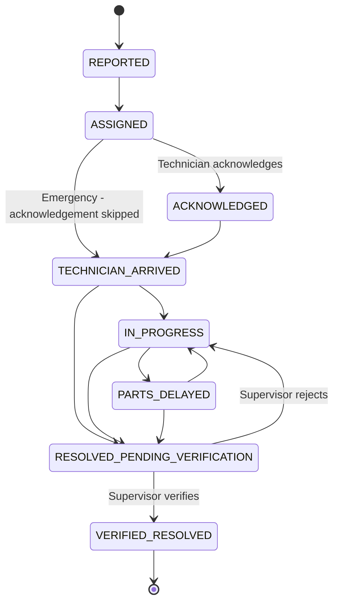
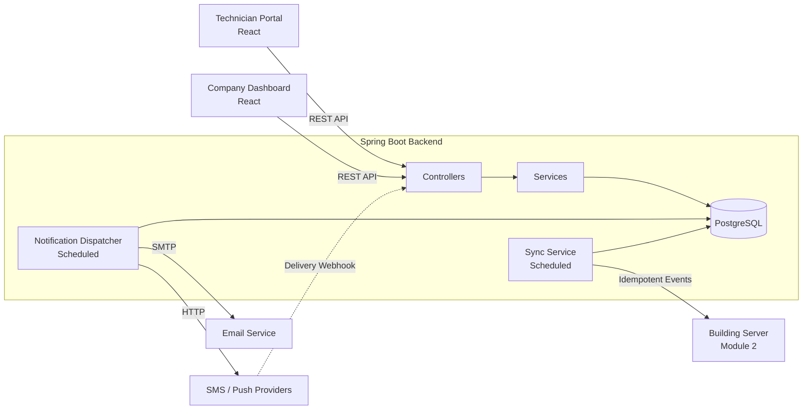

<div align="center">

# 🛗 LiftCare
### Elevator Issue Management · Technician Operations · Service Analytics

**From fault report to verified repair — with offline-first technician workflows, SLA escalation, notifications, and service insights.**

<p>
  
  
  
  
  
</p>

</div>

---

## Contents

- [Overview](#-overview)
- [Project scope](#-project-scope)
- [Features](#-features)
- [Incident lifecycle](#-incident-lifecycle)
- [Architecture](#-architecture)
- [Technology stack](#-technology-stack)
- [Project structure](#-project-structure)
- [Getting started](#-getting-started)
- [Configuration](#-configuration)
- [API overview](#-api-overview)
- [Testing checklist](#-testing-checklist)
- [Integration](#-integration-with-other-modules)
- [Known limitations](#-known-limitations)
- [Author](#-author)

---

## 📖 Overview

**LiftCare** is an elevator fault-management platform designed to help residential buildings report elevator issues, monitor service deadlines, and coordinate repairs with elevator service teams.

This repository contains **Module 4: Technician Portal, Company Dashboard, Notifications, and Analytics**. It supports the service workflow from technician assignment through repair and supervisor verification.

The wider LiftCare system is divided into four modules:

| Module | Responsibility |
|:--:|---|
| 1 | User management, buildings, elevators, and issue reporting |
| 2 | Building control room, local server, and offline-first processing |
| 3 | Priority, SLA deadlines, and automatic escalation |
| **4** | **Technician portal, company dashboard, notifications, and analytics** |

## 🎯 Project scope

This module connects technicians, company supervisors, and building managers through a shared incident workflow.

### 🔧 Technician portal
- View assigned jobs, with critical and high-priority incidents surfaced first.
- Track resolution deadlines with a live countdown and overdue indicator.
- Acknowledge jobs, record arrival, add progress notes, report parts delays, and mark repairs complete.
- Record the root cause, repair work, and replaced parts.
- Review a timestamped event timeline for each job.
- Queue actions while offline and synchronize them in order when connectivity returns.
- Use idempotency keys to prevent duplicate actions during retries.

### 🏢 Company and supervisor dashboard
- Review escalated and overdue incidents.
- Assign or reassign technicians and view their open-job counts.
- Verify completed repairs or reject them for further work.
- Check notification delivery status for each incident.

### 🔔 Notification management
- Send email through SMTP and SMS/push through configurable HTTP providers.
- Store outgoing messages in a durable outbox.
- Retry failed delivery attempts with increasing delays.
- Distinguish between **sent** and **provider-confirmed delivered** messages.
- Allow supervisors to acknowledge that an escalation has been seen.

### 📊 Analytics and reporting
- Track incident volume, open incidents, SLA breaches, and SLA compliance.
- Measure average response, arrival, and resolution times.
- Monitor elevator downtime.
- View incident volume by day and priority (P0–P3).
- Detect repeat faults affecting the same elevator.
- Review elevator service history, including root causes and replaced parts.
- Export performance data as CSV.

### 🔄 Offline synchronization
Technician and company actions can be queued while offline and sent to the building server when it becomes reachable. Idempotency keys help ensure that retries do not create duplicate events.

---

## 🔁 Incident lifecycle



### Important workflow rules

1. **Resolved does not mean closed.** A technician's repair action moves the incident to `RESOLVED_PENDING_VERIFICATION`. The incident is closed only after supervisor verification.
2. **Escalation is independent of lifecycle status.** The SLA module manages `red_flag` and `escalated_at`; these fields do not replace or alter the incident lifecycle.

---

## 🏗️ Architecture



PostgreSQL stores the module's application state, including jobs, timestamps, and queued notifications, so these records persist across backend restarts.

---

## 🧰 Technology stack

| Layer | Technologies |
|---|---|
| Backend | Java 17, Spring Boot 3.2, Spring JDBC |
| Frontend | React 18, Vite 5 |
| Database | PostgreSQL 16 |
| Email | Jakarta Mail / SMTP |
| Integrations | REST APIs, HTTP notification providers, webhooks |
| Reporting | CSV export |

---

## 📁 Project structure

```text
liftcare-member4/
├── database/
│   ├── schema.sql
│   └── seed.sql
├── docs/
│   └── API.md
├── backend/
│   ├── pom.xml
│   └── src/main/java/com/liftcare/m4/
│       ├── common/          # Response envelope, errors, auth stub, CORS
│       ├── technician/      # Technician jobs, actions, and endpoints
│       ├── company/         # Escalations, overdue jobs, assignment, verification
│       ├── notification/    # Outbox, channels, dispatcher, delivery webhook
│       ├── analytics/       # KPIs, repeat faults, history, CSV report
│       └── sync/            # Events sent to the building server
└── frontend/
    └── src/
        ├── api.js
        ├── offlineQueue.js
        ├── ui.jsx
        └── pages/
            # TechnicianPortal, CompanyDashboard,
            # Analytics, ElevatorHistory
```

---

## 🚀 Getting started

### Prerequisites

Install the following before running the project:

| Requirement | Version |
|---|---:|
| Java | 17 or newer |
| Maven | 3.8+ |
| Node.js | 18 or newer |
| PostgreSQL | 14 or newer |

### 1. Clone the repository

Replace the URL and folder name with your GitHub repository details.

```bash
git clone https://github.com/YOUR_USERNAME/YOUR_REPO.git
cd YOUR_REPO/liftcare-member4
```

### 2. Create and seed the database

```bash
createdb liftcare
psql liftcare -f database/schema.sql -f database/seed.sql
```

If your team already uses the shared database schema, skip `schema.sql` and ensure the existing column names match this module's expectations.

### 3. Configure and run the backend

From the project root:

```bash
export DB_USER=$(whoami)
export DB_PASSWORD=
cd backend
mvn spring-boot:run
```

The backend API starts at:

```text
http://localhost:8084
```

Quick API check:

```bash
curl -s http://localhost:8084/api/technician/jobs \
  -H "X-User-Id: 3" \
  -H "X-User-Role: TECHNICIAN"
```

### 4. Run the frontend

Open a second terminal:

```bash
cd frontend
npm install
npm run dev
```

Open the Vite development server:

```text
http://localhost:5173
```

Vite is configured to proxy `/api` requests to the backend.

### Development sample users

| User | Role | Access |
|---|---|---|
| Ravi | Technician | Assigned jobs, including a P0 passenger-trapped incident and a P2 door fault |
| Mani | Technician | Assigned overdue noise fault |
| Priya | Company supervisor | Escalations, analytics, history, assignment, and verification |
| Kumar | Building manager | Escalations, analytics, history, and verification |
| Admin | Admin | All module features |

> **Development authentication only:** the current sign-in stub sends `X-User-Id` and `X-User-Role` headers. It is intended to be replaced with Module 1's real JWT authentication before production use.

---

## ⚙️ Configuration

Configuration can be supplied through environment variables or `backend/src/main/resources/application.yml`.

| Variable | Default | Description |
|---|---|---|
| `DB_URL` | `jdbc:postgresql://localhost:5432/liftcare` | PostgreSQL connection URL |
| `DB_USER` | `liftcare` | Database username |
| `DB_PASSWORD` | `liftcare` | Database password |
| `CORS_ORIGIN` | `http://localhost:5173` | Allowed frontend origin |
| `MAIL_HOST` | `localhost` | SMTP host |
| `MAIL_PORT` | `1025` | SMTP port (MailHog can be used for testing) |
| `MAIL_USER` / `MAIL_PASSWORD` | Empty | SMTP credentials |
| `SMS_URL` / `SMS_API_KEY` | Empty | SMS provider endpoint and API key |
| `PUSH_URL` / `PUSH_API_KEY` | Empty | Push provider endpoint and API key |
| `WEBHOOK_SECRET` | `change-me` | Secret used to validate delivery callbacks |
| `SYNC_ENABLED` | `false` | Enables synchronization with the building server |
| `BUILDING_SERVER_URL` | `http://localhost:8080` | Building server base URL |

**Notification note:** SMS and push are disabled until enabled in `application.yml` and configured with a provider URL. Without a working provider, those messages retry and eventually become `FAILED`; they are not marked as delivered.

---

## 📡 API overview

All API responses use a common response envelope:

```json
{
  "success": true,
  "data": {},
  "error": null,
  "timestamp": "2026-10-31T09:00:00Z"
}
```

| Module area | Main endpoints |
|---|---|
| Technician | `GET /api/technician/jobs` · `POST /api/technician/jobs/{id}/acknowledge` · `/arrive` · `/progress` · `/parts-delay` · `/resolve` · `GET .../timeline` |
| Company | `GET /api/company/escalations` · `/overdue` · `/technicians` · `POST /api/company/incidents/{id}/assign` · `/verify` |
| Notifications | `GET /api/notifications` · `POST /api/notifications/webhook/{provider}` · `POST /api/notifications/{id}/acknowledge` |
| Analytics | `GET /api/analytics/summary` · `/volume` · `/by-priority` · `/repeat-faults` · `/elevators/{id}/history` · `/report` |
| Sync | `GET /api/sync/status` |

Error codes:

| Status | Meaning |
|---:|---|
| `400` | Validation error |
| `401` | Unauthenticated |
| `403` | Forbidden |
| `404` | Resource not found |
| `409` | Invalid state transition |

See [`docs/API.md`](docs/API.md) for endpoint details, request bodies, and role requirements.

### Delivery status webhook example

A notification is marked **Delivered** only after the provider confirms delivery through its webhook.

```bash
curl -X POST http://localhost:8084/api/notifications/webhook/sms \
  -H "Content-Type: application/json" \
  -H "X-Webhook-Secret: change-me" \
  -d '{"providerMessageId":"<id>","status":"delivered"}'
```

---

## 🧪 Testing checklist

Use the following manual checks to validate the main workflows:

- [ ] **Complete repair flow:** Sign in as Ravi, acknowledge `INC-2026-0001`, arrive, add a progress note, and mark it repaired. Sign in as Priya and verify the repair.
- [ ] **Offline queue:** Set the browser network to Offline, perform technician actions, reconnect, and confirm queued actions synchronize once.
- [ ] **Duplicate protection:** Replay the same `clientActionId` and confirm the API returns `duplicate: true`.
- [ ] **Delivery status:** Confirm a `SENT` notification remains “Sent, not confirmed” until the provider webhook confirms delivery.
- [ ] **Role permissions:** Confirm Mani cannot act on Ravi's job and receives `403`; confirm a technician cannot access `/api/company/escalations`.
- [ ] **Persistence:** Restart the backend and verify incident states, timestamps, and queued notifications remain available.

---

## 🔗 Integration with other modules

LiftCare is designed to operate as part of a shared project.

| Module | Integration contract |
|---|---|
| **Module 1 — Users and issues** | Replace the development `X-User-Id` and `X-User-Role` headers with the real JWT principal. Keep role names consistent. |
| **Module 2 — Building server** | Owns the `notification_outbox` queue and provides `POST /api/sync/events`. Duplicate events should be ignored using `clientActionId`. |
| **Module 3 — SLA and escalation** | Sets `red_flag`, `escalated_at`, `escalation_reason`, and incident deadlines; queues escalation messages with `kind = 'ESCALATION'`. |

Shared integration rules:
- Use one shared database schema.
- Keep one incident ID across all modules.
- Use a consistent API response format.
- Timestamp every status change.
- Do not hardcode SLA durations.

---

## ⚠️ Known limitations

- Authentication is currently a development stub and must be integrated with Module 1 before production deployment.
- SMS and push notifications require real provider credentials and may need adapter changes to match the provider's API.
- Synchronization depends on the building server implementing the contract described above.
- Automated tests are not included yet; the checklist above describes manual validation.

---

## 👨‍💻 Author

**Chandan Kumar Sharma** · Member 4  
Department of Computer Science and Engineering  
KPR Institute of Engineering and Technology, Coimbatore

---

<div align="center">

**LiftCare — making elevator service workflows more accountable.**

If you find this project useful, consider giving the repository a ⭐

</div>
